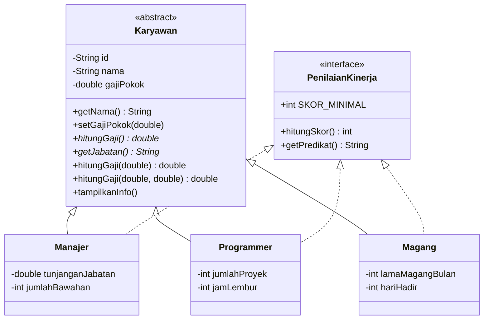
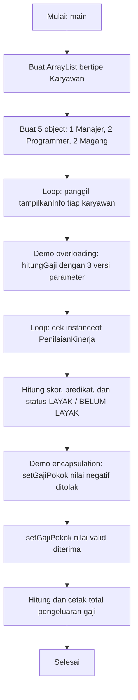

# Program Java: Sistem Penggajian Karyawan

Program Java sederhana yang menerapkan konsep **Pemrograman Berorientasi Objek (OOP)**: Encapsulation, Inheritance, Polymorphism, Abstract Class, dan Interface. Studi kasusnya adalah penggajian tiga jenis karyawan perusahaan dengan rumus gaji yang berbeda-beda.

---

## Tema

Sebuah perusahaan memiliki beberapa jenis karyawan:

| Jenis | Rumus gaji |
|---|---|
| **Manajer** | gaji pokok + tunjangan jabatan + (jumlah bawahan × Rp250.000) |
| **Programmer** | gaji pokok + (jumlah proyek × Rp1.000.000) + (jam lembur × Rp50.000) |
| **Magang** | uang saku + (hari hadir × Rp20.000) |

Semua jenis karyawan juga bisa **dinilai kinerjanya** (skor dan predikat). Skor di bawah **70** dinyatakan belum layak mendapat apresiasi.

**Hubungan logis antar komponen:**

- **Karyawan** (abstract class / superclass): konsep umum karyawan.
- **Manajer, Programmer, Magang** (subclass): jenis-jenis khusus karyawan.
- **PenilaianKinerja** (interface): kemampuan yang dimiliki semua jenis karyawan untuk dinilai.

---

## Struktur Class



---

## Alur Program



**Penjelasan singkat:**

1. Lima object karyawan dibuat dari tiga subclass, lalu disimpan dalam satu `ArrayList<Karyawan>`.
2. Setiap object menampilkan info lewat `tampilkanInfo()`. Karena object aslinya berbeda, hasil cetaknya ikut berbeda (**runtime polymorphism**).
3. Satu object dipakai untuk mendemonstrasikan tiga versi `hitungGaji(...)` (**overloading**).
4. Tiap karyawan dinilai lewat interface `PenilaianKinerja`, lalu ditentukan layak atau belum layak.
5. Setter `setGajiPokok()` diuji dengan nilai tidak valid (ditolak) dan nilai valid (diterima) untuk menunjukkan **encapsulation**.
6. Terakhir, total pengeluaran gaji seluruh karyawan dicetak.

---

## Cara Menjalankan

```bash
javac Main.java
java Main
```

---

## Output Program

Berikut hasil eksekusi program dalam bentuk teks (sudah dijalankan langsung):

```
========== DAFTAR KARYAWAN (Runtime Polymorphism) ==========
ID         : K001
Nama       : Andi Wijaya
Jabatan    : Manajer
Gaji       : Rp 16.250.000
Bawahan    : 5 orang
------------------------------------------------------------
ID         : K002
Nama       : Siti Rahma
Jabatan    : Programmer
Gaji       : Rp 11.500.000
Proyek     : 3 proyek, lembur 10 jam
------------------------------------------------------------
ID         : K003
Nama       : Budi Hartono
Jabatan    : Programmer
Gaji       : Rp 8.700.000
Proyek     : 1 proyek, lembur 4 jam
------------------------------------------------------------
ID         : K004
Nama       : Dewi Lestari
Jabatan    : Karyawan Magang
Gaji       : Rp 2.500.000
Magang     : 3 bulan, hadir 25 hari
------------------------------------------------------------
ID         : K005
Nama       : Rizky Fadhil
Jabatan    : Karyawan Magang
Gaji       : Rp 1.800.000
Magang     : 2 bulan, hadir 15 hari
------------------------------------------------------------

========== DEMO METHOD OVERLOADING ==========
Karyawan                         : Andi Wijaya
hitungGaji()                     : Rp 16.250.000
hitungGaji(bonus 2 jt)           : Rp 18.250.000
hitungGaji(bonus 2 jt, pot 500rb): Rp 17.750.000

========== PENILAIAN KINERJA (Interface) ==========
Andi Wijaya -> skor 85 (Baik) : LAYAK dapat apresiasi
Siti Rahma -> skor 80 (Baik) : LAYAK dapat apresiasi
Budi Hartono -> skor 60 (Perlu Ditingkatkan) : BELUM LAYAK dapat apresiasi
Dewi Lestari -> skor 90 (Sangat Baik) : LAYAK dapat apresiasi
Rizky Fadhil -> skor 70 (Baik) : LAYAK dapat apresiasi

========== DEMO ENCAPSULATION ==========
Gaji pokok Budi sebelum : Rp 7.500.000
Perubahan ditolak       : Gaji pokok tidak boleh negatif
Gaji pokok Budi sesudah : Rp 8.000.000
Total gaji Budi sekarang: Rp 9.200.000

Total pengeluaran gaji 5 karyawan: Rp 41.250.000
```

**Catatan hasil:**

- Budi satu-satunya yang **belum layak** karena skor 60 berada di bawah batas 70.
- Rizky tepat di skor 70, jadi masih dinyatakan layak.
- Setter menolak gaji pokok negatif, sedangkan nilai valid diterima dan langsung memengaruhi total gaji Budi.

---

## Ketentuan yang Terpenuhi

| Ketentuan | Implementasi |
|---|---|
| **Encapsulation** | Atribut `private` + getter/setter dengan validasi |
| **Inheritance** | `Manajer`, `Programmer`, `Magang` `extends Karyawan`, dengan `super(...)` |
| **Polymorphism** | `@Override` (`hitungGaji`, `getJabatan`, `tampilkanInfo`), overloading `hitungGaji(...)`, dan `ArrayList<Karyawan>` berisi object subclass |
| **Abstract Class** | `Karyawan` dengan abstract method `hitungGaji()` dan `getJabatan()` |
| **Interface** | `PenilaianKinerja`, diimplementasikan dengan `implements` oleh tiga subclass |
| **Tambahan** | 6 tipe (termasuk `Main`) dan 5 object |

---

## Identitas Lab Session 1
**Mata Kuliah:** Pemrograman Berorientasi Objek<br>
**Lab Session:** 02<br>
**Materi:** Encapsulation, Inheritance, Polymorphism, Abstract Class, dan Interface dalam Java: Studi Kasus Sistem Penggajian Karyawan<br>
**Nama:** Nabila Salma Az Zahra<br>
**NIM:** L0325031<br>
**Asisten Praktikum:** Hammam Ibnu Adi Abdillah<br>
**NIM Asisten:** L0324015<br>
**Asisten Praktikum:** Muhammad Ihsaan Al Fikri<br>
**NIM Asisten:** L0324024<br>
**Program Studi:** Informatika PSDKU Kebumen<br>
**Universitas:** Universitas Sebelas Maret<br>
**Tahun:** 2026<br>