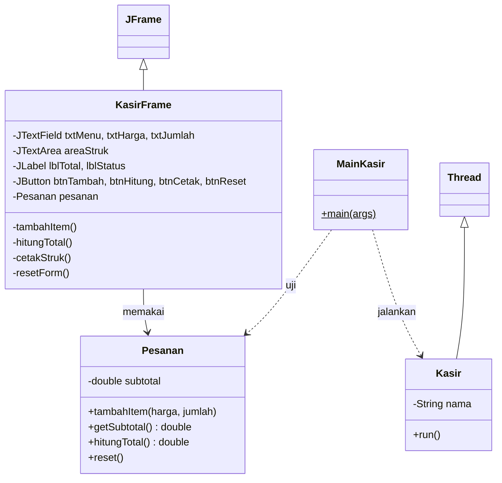
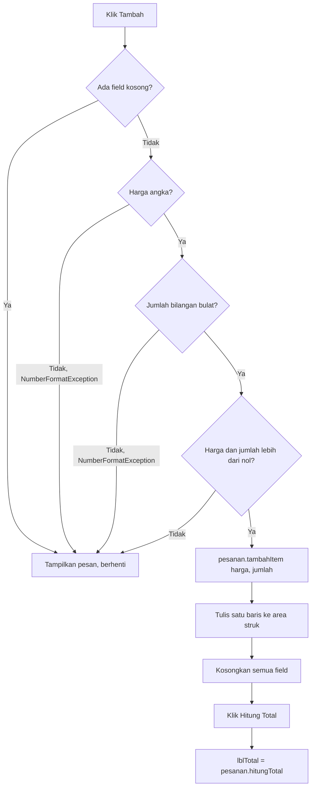
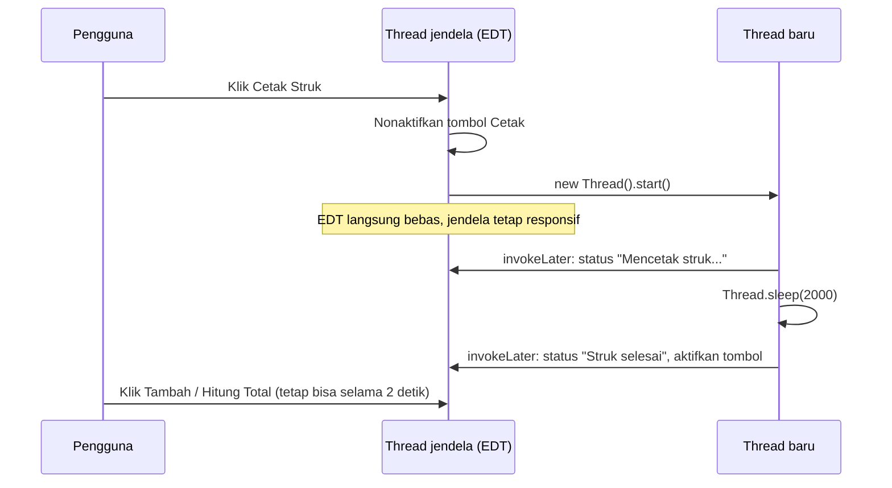
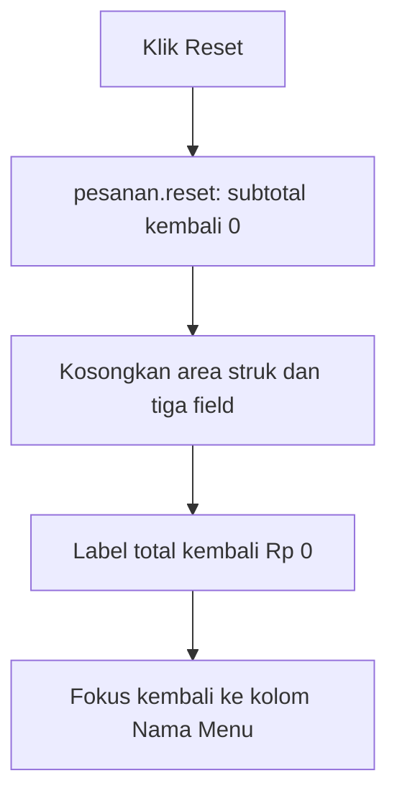

# Kasir Kantin UNS

Aplikasi kasir sederhana berbasis Java yang dikerjakan bertahap (Tahap 1–4): logika harga, simulasi dua kasir dengan **multithreading**, tampilan jendela dengan **Java Swing**, dan tombol cetak struk yang berjalan di **thread terpisah** agar jendela tidak macet.

Praktikum PBO Kelas 3B — Lab Session (Multithreading) dan 12 (GUI Programming).

---

## Tema

Kantin UNS ingin aplikasi kasir berbasis jendela. Kasir memasukkan **menu, harga, dan jumlah**, lalu aplikasi menghitung total bayar. Selain itu dibuat simulasi **dua kasir yang melayani pelanggan bersamaan**, serta fitur **cetak struk** yang tidak membuat jendela macet.

**Aturan harga:** jika subtotal **lebih dari Rp 50.000**, pelanggan mendapat **diskon 10%**.

| Tahap | Isi | Konsep |
|---|---|---|
| 1 | Class `Pesanan` (logika harga) | Enkapsulasi, kondisional |
| 2 | Dua kasir sebagai thread | `extends Thread`, `start()`, `join()` |
| 3 | Jendela kasir | Swing, `setBounds()`, event handling, validasi |
| 4 | Tombol Cetak Struk | Thread baru, `SwingUtilities.invokeLater` |

> **Tambahan (opsional):** jendela juga memiliki tombol **Reset** untuk membersihkan halaman. Tombol ini tidak diminta soal dan boleh dihapus jika tidak diperlukan.

---

## Struktur Project

Semua class berada dalam satu package, `lab.kasir`:

```
lab-kasir/
└── lab/
    └── kasir/
        ├── Pesanan.java      ← Tahap 1: logika harga (tanpa GUI)
        ├── Kasir.java        ← Tahap 2: kasir sebagai Thread
        ├── MainKasir.java    ← Tahap 1 dan 2: uji versi console
        └── KasirFrame.java   ← Tahap 3 dan 4: jendela Swing
```



Prinsip desainnya: `KasirFrame` hanya mengurus **tampilan dan event**, sedangkan seluruh perhitungan harga (subtotal dan diskon) milik `Pesanan`.

---

## Alur Program

### Alur tombol Tambah dan Hitung Total (Tahap 3)



### Alur tombol Cetak Struk (Tahap 4)



**Penjelasan singkat:**

1. Penantian 2 detik **tidak boleh** dilakukan di thread jendela (Event Dispatch Thread), karena jendela akan membeku selama tidur. Karena itu penantian dipindahkan ke thread baru.
2. Komponen Swing hanya aman diubah dari thread jendela, jadi perubahan label dari thread baru dititipkan lewat `SwingUtilities.invokeLater(...)`.
3. Tombol Cetak dinonaktifkan selama proses agar tidak bisa diklik dua kali. Tombol Tambah dan Hitung Total tidak dikunci.

### Alur tombol Reset (tambahan)



`pesanan.reset()` wajib dipanggil. Jika hanya area struk yang dikosongkan, subtotal lama masih tersimpan sehingga **Hitung Total** berikutnya tetap menyertakan item yang sudah hilang dari layar. Label status sengaja tidak ikut di-reset agar tulisan "Mencetak struk..." tidak tertimpa saat pencetakan masih berjalan.

---

## Cara Menjalankan

```bash
cd lab-kasir
javac -d out lab/kasir/*.java

java -cp out lab.kasir.MainKasir      # Tahap 1 dan 2 (console)
java -cp out lab.kasir.KasirFrame     # Tahap 3 dan 4 (jendela)
```

> **Catatan input harga:** isi angka **tanpa titik atau koma** (contoh `15000`). Jika diketik `15.000`, Java membacanya sebagai 15.

---

## Hasil dan Output

### Tahap 1 dan 2: output console

Hasil dari `java -cp out lab.kasir.MainKasir`:

```
=== TAHAP 1: Uji Pesanan ===
Setelah 2 menu -> subtotal: Rp 45.000, total: Rp 45.000
Setelah 3 menu -> subtotal: Rp 70.000, total: Rp 63.000
Setelah reset  -> subtotal: Rp 0

=== TAHAP 2: Dua kasir ===
Kasir Dina melayani pelanggan ke-1
Kasir Eko melayani pelanggan ke-1
Kasir Dina melayani pelanggan ke-2
Kasir Eko melayani pelanggan ke-2
Kasir Eko melayani pelanggan ke-3
Kasir Dina melayani pelanggan ke-3
Kasir Eko melayani pelanggan ke-4
Kasir Dina melayani pelanggan ke-4
Kasir Dina melayani pelanggan ke-5
Kasir Eko melayani pelanggan ke-5
Semua pelanggan selesai dilayani
```

**Pengamatan:**

- **Tahap 1:** sesuai harapan. Dua menu pertama Rp 45.000 (tanpa diskon), setelah menu ketiga subtotal Rp 70.000 dan total **Rp 63.000** (diskon 10% = Rp 7.000).
- **Tahap 2:** program dijalankan **2 kali**. Urutan Dina dan Eko **tidak selalu sama**. Pada jalan ke-1, Eko pelanggan ke-3 tampil sebelum Dina. Pada jalan ke-2, Dina tampil lebih dulu. Kalimat "Semua pelanggan selesai dilayani" **selalu paling akhir** berkat `join()`.
- Alasan urutan berbeda: penjadwal sistem operasi yang menentukan thread mana yang dapat giliran lebih dulu, jadi urutannya tidak dijamin.

### Tahap 3: tampilan jendela kasir

Dengan data uji berikut:

| Menu | Harga | Jumlah | Subtotal |
|---|---|---|---|
| Nasi Goreng | 15000 | 2 | 30.000 |
| Es Teh | 5000 | 3 | 15.000 |
| Ayam Bakar | 25000 | 1 | 25.000 |

Tampilan yang diharapkan setelah ketiga menu ditambahkan dan **Hitung Total** diklik:

```
Nasi Goreng | 2 x Rp 15.000 = Rp 30.000
Es Teh | 3 x Rp 5.000 = Rp 15.000
Ayam Bakar | 1 x Rp 25.000 = Rp 25.000

Total Bayar : Rp 63.000
```

Setelah dua menu pertama, total yang tampil adalah **Rp 45.000** (tanpa diskon).

**Validasi input** (pesan muncul lewat `JOptionPane`):

| Kondisi | Pesan |
|---|---|
| Salah satu field kosong | Semua field (menu, harga, jumlah) harus diisi. |
| Harga bukan angka | Harga harus berupa angka (tanpa titik/koma, contoh: 15000). |
| Jumlah bukan bilangan bulat | Jumlah harus berupa bilangan bulat. |
| Harga atau jumlah nol atau negatif | Harga dan jumlah harus lebih dari nol. |


### Tahap 4: tombol Cetak Struk

Label status berubah mengikuti urutan berikut:

| Waktu | Label status |
|---|---|
| Sebelum klik | `Status : siap` |
| Klik Cetak Struk, sampai ±2 detik | `Status : Mencetak struk...` |
| Setelah 2 detik | `Status : Struk selesai` |


**Cara membuktikan jendela tidak macet:** saat status masih "Mencetak struk...", tambahkan satu menu dengan **Tambah** lalu klik **Hitung Total**. Keduanya harus tetap langsung bekerja.

### Tombol Reset (tambahan)

Tombol **Reset** ada di pojok kanan bawah, di samping label status.

Perilaku yang diharapkan setelah **Reset** diklik:

| Bagian | Setelah Reset |
|---|---|
| Area struk | kosong |
| Field menu, harga, jumlah | kosong |
| Label total | `Total Bayar : Rp 0` |
| Data pesanan | kembali 0 (item berikutnya dihitung dari nol) |
| Label status | tidak berubah |

**Cara memeriksanya:** tambahkan beberapa menu, klik **Reset**, lalu tambahkan satu menu baru (misalnya Es Teh 5000 × 1) dan klik **Hitung Total**. Totalnya harus `Rp 5.000`, bukan tercampur pesanan sebelumnya.

---

## ✅ Checklist Hasil yang Diharapkan
 
| Tahap | Kriteria | Status |
|---|---|---|
| 1 | Dua menu pertama: total 45.000 tanpa diskon | ✅ |
| 1 | Menu ketiga: subtotal 70.000, total 63.000 | ✅ |
| 2 | Output Dina dan Eko bergantian, urutan bisa berbeda | ✅ |
| 2 | "Semua pelanggan selesai dilayani" selalu paling akhir | ✅ |
| 3 | Komponen dibuat dengan `setBounds()` dan jendela tampil | ✅ |
| 3 | Label total menampilkan 63.000 dengan data uji | ✅ |
| 3 | Validasi field kosong dan non-angka muncul lewat `JOptionPane` | ✅ |
| 4 | Thread baru dijalankan dengan `start()` | ✅ |
| 4 | Tambah dan Hitung Total tetap bisa ditekan saat mencetak | ✅ |
| 4 | Label berubah dari mencetak menjadi selesai | ✅ |
| Tambahan | Reset mengosongkan struk, field, total, dan data pesanan | ✅ |
 

## Identitas Lab Session 3

**Mata Kuliah:** Pemrograman Berorientasi Objek<br>
**Lab Session:** 03<br>
**Materi:** Multithreading dan GUI Programming dalam Java: Studi Kasus Kasir Kantin UNS<br>
**Nama:** Nabila Salma Az Zahra<br>
**NIM:** L0325031<br>
**Asisten Praktikum:** Hammam Ibnu Adi Abdillah<br>
**NIM Asisten:** L0324015<br>
**Asisten Praktikum:** Muhammad Ihsaan Al Fikri<br>
**NIM Asisten:** L0324024<br>
**Program Studi:** Informatika PSDKU Kebumen<br>
**Universitas:** Universitas Sebelas Maret<br>
**Tahun:** 2026<br>