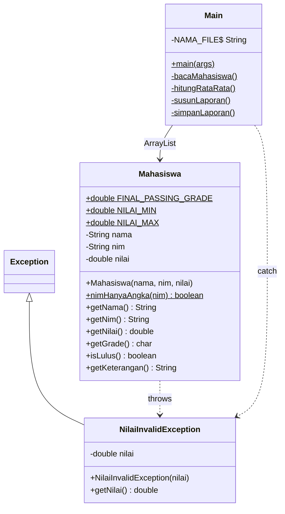
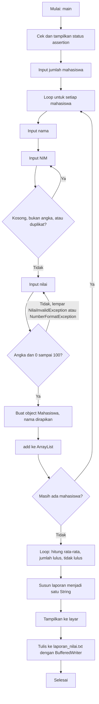

# Program Java: Pengelolaan Nilai Mahasiswa

Program Java berorientasi objek yang membaca data mahasiswa dari keyboard, memvalidasinya dengan **Assertion** dan **Custom Exception**, mengelola data dengan **ArrayList**, memproses teks dengan **String** dan **Character**, lalu menyimpan rekapitulasi ke file `laporan_nilai.txt` dengan **File I/O**.

---

## Tema

Seorang dosen ingin merekap nilai mahasiswa. Untuk setiap mahasiswa, program meminta:

| Data | Tipe | Aturan |
|---|---|---|
| Nama | `String` | tidak boleh kosong; dirapikan otomatis (spasi, huruf kapital) |
| NIM | `String` | tidak boleh kosong, hanya angka, tidak boleh duplikat |
| Nilai | `double` | harus antara 0 sampai 100 |

Nilai dipetakan ke grade dan status kelulusan (standar kelulusan `FINAL_PASSING_GRADE = 70.0`):

| Nilai | Grade | Status |
|---|---|---|
| ≥ 85 | A | Lulus |
| 75 – < 85 | B | Lulus |
| 70 – < 75 | C | Lulus |
| < 70 | D | Tidak Lulus |

Di akhir, program menampilkan dan menyimpan laporan berisi daftar mahasiswa, **rata-rata nilai kelas**, serta **jumlah lulus dan tidak lulus**.

---

## Struktur Project

```
nilai-mahasiswa/
├── model/                          ← package kelas data
│   ├── Mahasiswa.java
│   └── NilaiInvalidException.java
└── app/                            ← package kelas utama
    └── Main.java
```



---

## Alur Program



**Penjelasan singkat:**

1. Program menampilkan status assertion, lalu meminta jumlah mahasiswa.
2. Untuk tiap mahasiswa, input divalidasi berlapis dan diminta ulang sampai benar. Nilai di luar 0–100 memicu `NilaiInvalidException`.
3. Saat object `Mahasiswa` dibuat, nama dirapikan (`trim()`, `toUpperCase()`), dan `assert` memastikan NIM tidak kosong.
4. Semua object disimpan di `ArrayList<Mahasiswa>`.
5. Statistik dihitung dengan `for-each`, laporan disusun sekali, ditampilkan ke layar, lalu ditulis ke file (isi layar dan isi file identik).

---

## Cara Menjalankan

Dari folder `nilai-mahasiswa`:

```bash
javac -d out model/*.java app/*.java
java -ea -cp out app.Main
```

> **Penting:** flag `-ea` (enable assertions) wajib dipakai agar `assert` aktif. Tanpa `-ea`, Java mengabaikan assertion. Program tetap aman karena constructor punya pengecekan cadangan, dan status assertion ditampilkan di awal program.

File `laporan_nilai.txt` akan dibuat di folder tempat perintah `java` dijalankan (isinya ditimpa setiap kali program berjalan).

---

## Output Program

### Sesi Normal

Input pengguna ikut ditampilkan. Perhatikan nama `"  ani   lestari "` otomatis dirapikan menjadi `ANI LESTARI`.

```
=== PENGELOLAAN NILAI MAHASISWA ===
Status assertion: AKTIF
Masukkan jumlah mahasiswa: 3

Data mahasiswa ke-1
Nama          :   ani   lestari 
NIM           : 123456
Nilai (0-100) : 85,5

Data mahasiswa ke-2
Nama          : budi
NIM           : 654321
Nilai (0-100) : 65

Data mahasiswa ke-3
Nama          : citra dewi
NIM           : 111222
Nilai (0-100) : 70

Total data dimasukkan: 3

LAPORAN NILAI MAHASISWA
======================================================================
No  NIM         Nama                     Nilai   Grade  Status
----------------------------------------------------------------------
1   123456      ANI LESTARI              85.50   A      Lulus
2   654321      BUDI                     65.00   D      Tidak Lulus
3   111222      CITRA DEWI               70.00   C      Lulus
======================================================================
Jumlah mahasiswa      : 3
Standar kelulusan     : 70.0
Rata-rata nilai kelas : 73.50
Jumlah lulus          : 2
Jumlah tidak lulus    : 1

Laporan berhasil disimpan ke: /path/ke/nilai-mahasiswa/laporan_nilai.txt
```

**Catatan hasil:**

- Citra mendapat nilai tepat **70** dan dinyatakan **Lulus** (grade C), karena syaratnya `>= 70`.
- Rata-rata dihitung dari (85,5 + 65 + 70) / 3 = **73,50**.
- Koma desimal (`85,5`) diterima dan otomatis diubah menjadi `85.5`.

### Validasi Input

Semua input salah ditolak dan diminta ulang, program tidak berhenti:

```
=== PENGELOLAAN NILAI MAHASISWA ===
Status assertion: AKTIF
Masukkan jumlah mahasiswa: 2

Data mahasiswa ke-1
Nama          : ani
NIM           : A123
  [!] NIM hanya boleh berisi angka.
NIM           : 12x4
  [!] NIM hanya boleh berisi angka.
NIM           : 123456
Nilai (0-100) : 150
  [!] Nilai 150.0 tidak valid, harus antara 0.0 sampai 100.0
Nilai (0-100) : -5
  [!] Nilai -5.0 tidak valid, harus antara 0.0 sampai 100.0
Nilai (0-100) : abc
  [!] Nilai harus berupa angka.
Nilai (0-100) : NaN
  [!] Nilai NaN tidak valid, harus antara 0.0 sampai 100.0
Nilai (0-100) : 80

Data mahasiswa ke-2
Nama          : budi
NIM           : 123456
  [!] NIM sudah terdaftar.
NIM           : 654321
Nilai (0-100) : 65
...
```

| Input | Alasan ditolak | Ditangani oleh |
|---|---|---|
| NIM `A123`, `12x4` | mengandung huruf | `Character.isDigit()` |
| NIM `123456` (kedua kali) | duplikat | pengecekan `for-each` + `equals()` |
| Nilai `150`, `-5`, `NaN` | di luar 0–100 | `NilaiInvalidException` |
| Nilai `abc` | bukan angka | `NumberFormatException` |

### Isi file `laporan_nilai.txt`

```
LAPORAN NILAI MAHASISWA
======================================================================
No  NIM         Nama                     Nilai   Grade  Status
----------------------------------------------------------------------
1   123456      ANI LESTARI              85.50   A      Lulus
2   654321      BUDI                     65.00   D      Tidak Lulus
3   111222      CITRA DEWI               70.00   C      Lulus
======================================================================
Jumlah mahasiswa      : 3
Standar kelulusan     : 70.0
Rata-rata nilai kelas : 73.50
Jumlah lulus          : 2
Jumlah tidak lulus    : 1
```

### Perilaku assertion

| Cara menjalankan | NIM kosong sampai ke constructor |
|---|---|
| `java -ea ...` | `AssertionError: NIM tidak boleh kosong!` |
| `java ...` (tanpa `-ea`) | `IllegalArgumentException: NIM harus berisi angka saja` |

Dalam alur normal, NIM kosong sudah ditolak lebih dulu oleh `bacaNim()`, sehingga assertion berperan sebagai jaring pengaman.

---

## Indikator yang Terpenuhi

| Materi | Implementasi |
|---|---|
| Package, class, constructor, `final` | package `model` dan `app`; `Mahasiswa(nama, nim, nilai)`; `FINAL_PASSING_GRADE = 70.0` |
| Kondisional | `if-else` untuk grade, `switch-case` untuk keterangan |
| Looping, primitif vs reference | `for-each` untuk statistik; `double`/`boolean` vs `String`/`Mahasiswa` |
| Custom Exception | `NilaiInvalidException` dilempar jika nilai < 0 atau > 100 |
| Assertion | `assert !this.nim.isEmpty() : "NIM tidak boleh kosong!";` |
| String & Character | `trim()`, `replaceAll()`, `toUpperCase()`, `Character.isDigit()` |
| Collection | `ArrayList<Mahasiswa>` dengan `add()`, `size()`, `for-each` |
| Console I/O | `Scanner` dengan validasi dan input ulang |
| File I/O | `BufferedWriter` + `FileWriter` dalam try-with-resources, `catch (IOException)` |

---

## Identitas Praktikum

**Mata Kuliah:** Pemrograman Berorientasi Objek<br>
**Modul:** Pengganti 07<br>
**Materi:** Assertion, Custom Exception, ArrayList, String, Character, dan File I/O<br>
**Nama:** Nabila Salma Az Zahra<br>
**NIM:** L0325031<br>
**Asisten Praktikum :** Hammam Ibnu Adi Abdillah<br>
**NIM Asisten :** L0324015<br>
**Asisten Praktikum :** Muhammad Ihsaan Al Fikri<br>
**NIM Asisten :** L0324024<br>
**Program Studi:** Informatika PSDKU Kebumen<br>
**Universitas:** Universitas Sebelas Maret<br>
**Tahun:** 2026
