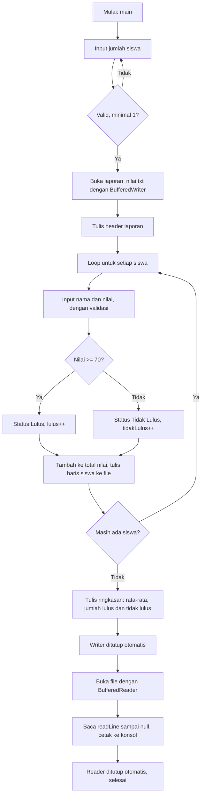

# Program Java: Laporan Nilai Siswa

Program Java sederhana bergaya **prosedural** untuk mengelola data nilai siswa. Program membaca data dari keyboard, menyimpannya ke file teks `laporan_nilai.txt`, lalu membaca kembali file tersebut dan menampilkannya di konsol.

---

## Tema

Seorang guru ingin mencatat nilai siswa dan menyimpannya sebagai laporan. Untuk setiap siswa, program meminta:

- **Nama** (`String`)
- **Nilai** (`double`, rentang 0–100)

Status kelulusan ditentukan otomatis:

| Kondisi | Status |
|---|---|
| Nilai ≥ 70 | **Lulus** |
| Nilai < 70 | **Tidak Lulus** |

Di akhir laporan, program menuliskan ringkasan: **rata-rata nilai kelas**, **jumlah siswa lulus**, dan **jumlah siswa tidak lulus**.

**Konsep yang diterapkan:**

- Input konsol dengan `Scanner` dan looping
- Penulisan file dengan `FileWriter` + `BufferedWriter`
- Pembacaan file dengan `FileReader` + `BufferedReader` (`readLine()` sampai `null`)
- Exception handling (`IOException`) dan **try-with-resources** agar stream ditutup otomatis
- Validasi input (angka tidak valid, nilai di luar 0–100, nama kosong)

---

## Struktur Program

```
LaporanNilai.java
├── main()                → mengatur urutan seluruh proses
├── bacaJumlahSiswa()     → input jumlah siswa (minimal 1)
├── tulisLaporan()        → Langkah 1: input data + tulis ke file
│     ├── bacaNama()      → input nama (tidak boleh kosong)
│     └── bacaNilai()     → input nilai (0–100)
└── bacaLaporan()         → Langkah 2: baca file + tampilkan ke konsol
```

---

## Alur Program



**Penjelasan singkat:**

1. Program meminta jumlah siswa dan mengulang sampai input valid.
2. File `laporan_nilai.txt` dibuat (jika sudah ada, isinya **ditimpa**) dan header ditulis.
3. Untuk tiap siswa, program membaca nama dan nilai, menentukan status, lalu langsung menulis satu baris ke file.
4. Setelah semua siswa diproses, ringkasan (rata-rata, jumlah lulus, jumlah tidak lulus) ditulis di akhir file.
5. Writer ditutup otomatis oleh try-with-resources, sehingga seluruh data pasti tersimpan.
6. File dibuka kembali dengan `BufferedReader`, dibaca baris demi baris, dan ditampilkan ke konsol sebagai bukti data berhasil tersimpan.

---

## Cara Menjalankan

```bash
javac LaporanNilai.java
java LaporanNilai
```

File `laporan_nilai.txt` akan dibuat di folder tempat perintah `java` dijalankan.

---

## Output Program

Contoh sesi lengkap dalam bentuk teks (input pengguna ikut ditampilkan):

```
=== PROGRAM LAPORAN NILAI SISWA ===
Masukkan jumlah siswa: 4

Data siswa ke-1
Nama siswa  : Ani Lestari
Nilai siswa : 85,5

Data siswa ke-2
Nama siswa  : Budi Santoso
Nilai siswa : 65

Data siswa ke-3
Nama siswa  : Citra Dewi
Nilai siswa : 70

Data siswa ke-4
Nama siswa  : Dimas Pratama
Nilai siswa : 55.25

Data berhasil ditulis ke file laporan_nilai.txt

========== ISI FILE laporan_nilai.txt ==========
LAPORAN NILAI SISWA
==================================================
No  Nama                     Nilai     Status
--------------------------------------------------
1   Ani Lestari              85.50     Lulus
2   Budi Santoso             65.00     Tidak Lulus
3   Citra Dewi               70.00     Lulus
4   Dimas Pratama            55.25     Tidak Lulus
==================================================
Rata-rata nilai kelas : 68.94
Jumlah siswa lulus    : 2
Jumlah tidak lulus    : 2
```

**Catatan hasil:**

- Citra mendapat nilai tepat **70**, dan dinyatakan **Lulus** karena syaratnya `>= 70`.
- Rata-rata dihitung dari (85,5 + 65 + 70 + 55,25) / 4 = **68,94**.
- Koma desimal (`85,5`) diterima dan otomatis diubah menjadi `85.5`.

### Contoh validasi input

Jika input salah, program tidak berhenti, melainkan meminta ulang:

```
Masukkan jumlah siswa: abc
Input tidak valid, masukkan bilangan bulat.
Masukkan jumlah siswa: 0
Jumlah siswa minimal 1.
...
Nilai siswa : 150
Nilai harus antara 0 sampai 100.
Nilai siswa : xyz
Input tidak valid, masukkan angka.
```

---

## Ketentuan yang Terpenuhi

| Ketentuan | Implementasi |
|---|---|
| Input dengan `Scanner` + looping | `bacaJumlahSiswa()` dan `for` di `tulisLaporan()` |
| Status kelulusan di dalam loop | `if (nilai >= NILAI_LULUS)` di dalam `for` |
| Tulis file | `BufferedWriter(new FileWriter(NAMA_FILE))` |
| Ringkasan di akhir file | rata-rata, jumlah lulus, jumlah tidak lulus |
| Baca file | `BufferedReader(new FileReader(NAMA_FILE))` + `readLine()` sampai `null` |
| Tampilkan isi file ke konsol | `System.out.println(baris)` |
| Exception handling & resource management | `try-with-resources` + `catch (IOException e)` |

---

## Identitas Praktikum
**Mata Kuliah:** Pemrograman Berorientasi Objek<br>
**Modul:** 06<br>
**Materi:** Input Output dalam Java<br>
**Nama:** Nabila Salma Az Zahra<br>
**NIM:** L0325031<br>
**Asisten Praktikum:** Hammam Ibnu Adi Abdillah<br>
**NIM Asisten:** L0324015<br>
**Asisten Praktikum:** Muhammad Ihsaan Al Fikri<br>
**NIM Asisten:** L0324024<br>
**Program Studi:** Informatika PSDKU Kebumen<br>
**Universitas:** Universitas Sebelas Maret<br>
**Tahun:** 2026<br>